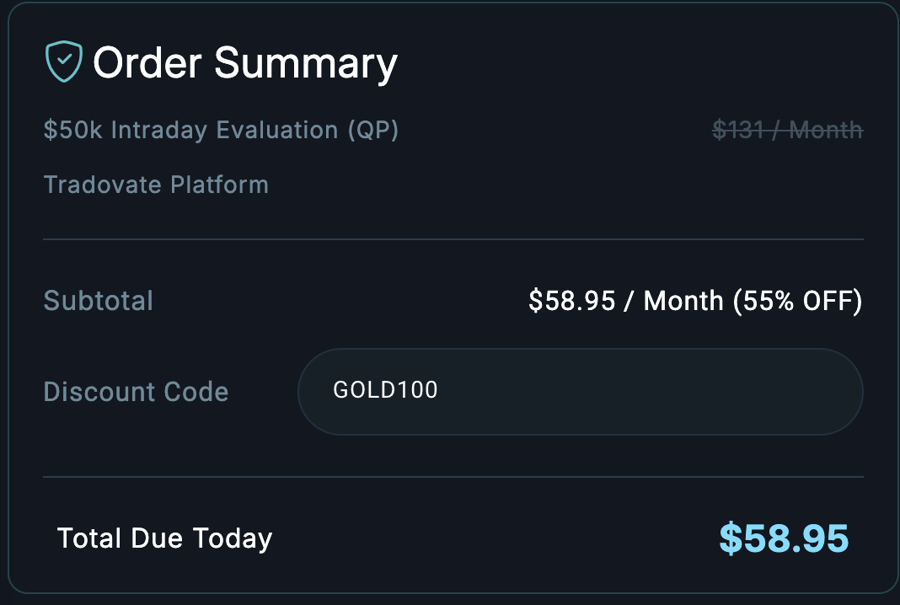

# TradeDay discount code: GOLD100 (as of November 2026)

**GOLD100 is a TradeDay discount code.** Type it in the Discount Code box in the Order Summary at checkout, before you pay for your evaluation.

## Where is the Discount Code box?

On the TradeDay checkout page, inside the Order Summary. It's entered at checkout, not during account registration.

## How do I use GOLD100?

1. Choose your TradeDay evaluation and trading platform.
2. Log in and continue to checkout.
3. Click the Discount Code box in the Order Summary.
4. Type `GOLD100` in capitals.
5. Compare Total Due Today with the list price, then pay.

## How much does it take off?

The discount is set by TradeDay and differs by plan. Your Order Summary shows the reduced price before you pay, so check it there.

## What usually goes wrong?

- Paying before entering the code.
- Typing GOLD1OO with a letter O.
- Looking for the box on the registration form instead of checkout.

## FAQ

**Promo code or discount code?** TradeDay labels the box Discount Code; some sites call it a promo code.

**Is a pass guaranteed?** No. The code only changes the price of the evaluation.

---
*Disclosure: GOLD100 is our code and we may earn a commission when it's used. Futures trading involves substantial risk of loss.*
